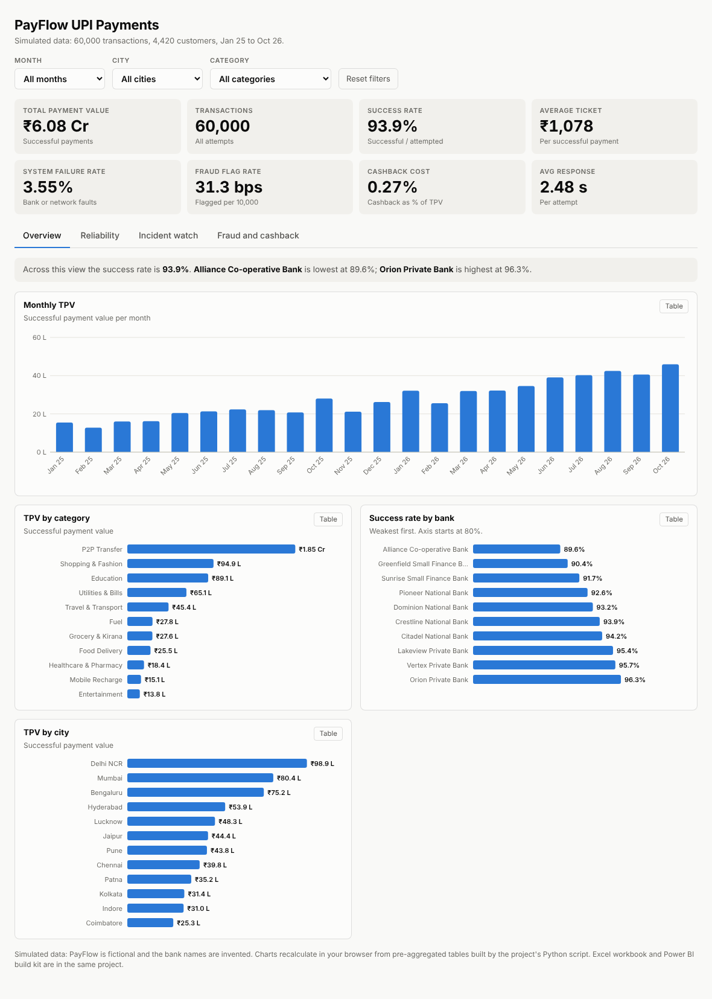
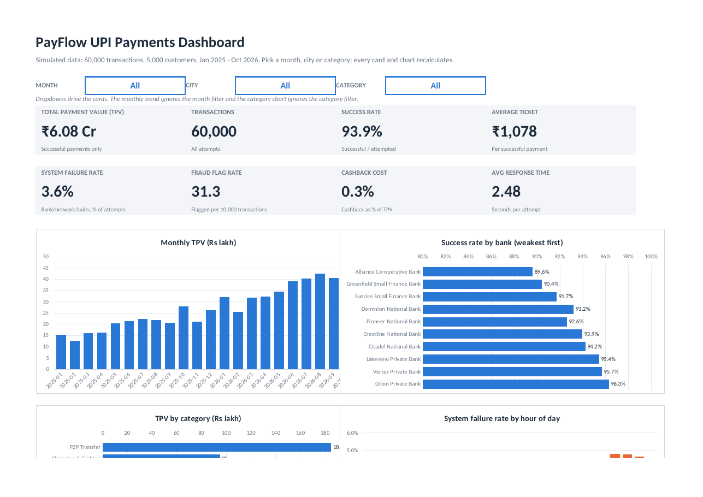

# PayFlow: UPI Payments Analytics (Excel + Power BI + live dashboard)

**Live dashboard:** `https://YOUR-USERNAME.github.io/payflow-upi-analytics/` &nbsp;·&nbsp; **Tools:** Excel (formulas, named ranges, tables), Power BI (star schema, DAX, Power Query), Python (data generation)

> A payments company wants to know why payments fail, which banks and hours are the weak spots, when an outage happened,
> who is most likely to be flagged for fraud, and what cashback costs. This project answers those questions three ways:
> a formula-driven **Excel workbook**, a **Power BI** build kit, and a **live web dashboard**.



## Key findings

All figures come from the simulated dataset (60,000 transactions, Jan 2025 to Oct 2026) and are reproduced in `excel/PayFlow_UPI_Analytics.xlsx` (sheet *Insights*).

| Question | Finding |
|---|---|
| Scale | Rs 6.08 Cr successful payment value (TPV), 93.9% success rate, average ticket Rs 1,078 |
| Growth | Monthly TPV rose from Rs 15.5 L to Rs 46.0 L, a 5.3% compound monthly growth rate, with a visible Diwali 2025 spike |
| Bank reliability | Alliance Co-operative Bank fails for system reasons 8.1% of the time against 1.4% at Orion Private Bank (5.8x). Small-finance and co-operative banks carry 18% of transactions but 35% of system failures |
| Value at risk | System failures put Rs 23.1 L (3.7%) of attempted payment value at risk |
| Peak and signal | System failure is 4.6% from 19:00 to 22:59 against 3.2% otherwise, and 7.1% on weak 2G/3G against 3.3% elsewhere |
| Outages | Dominion National Bank hit 60% on 13-15 Oct 2025 (4.7% rest of month); Greenfield Small Finance Bank 63% on 3-5 Mar 2026 (4.5%) |
| Fraud flags | 75 bps for customers in their first 30 days against 23 bps later; 81 bps from midnight to 04:59 against 30 bps otherwise |
| Cashback | 0.27% of TPV overall; Entertainment and Food Delivery cost 1.26% and 0.94% of their TPV |
| Tier 2 cities | Failure rate 3.5% against 3.6% in Tier 1: city tier does not explain failures; bank and network do |

## What is inside

| Part | What it is | Skills it shows |
|---|---|---|
| `excel/PayFlow_UPI_Analytics.xlsx` | 12-sheet workbook: dashboard with dropdown filters, monthly, failures, segments, fraud and cashback, incident finder, insights | 1,108 formula cells (`COUNTIFS`, `SUMIFS`, `AVERAGEIFS`), named ranges, Excel Table of 60,000 rows, data validation, conditional formatting, charts |
| `powerbi/` | Build kit for a 5-page Power BI report: cleaned star schema (6 CSVs), Power Query (M) scripts, 36 DAX measures, theme, step-by-step guide, expected values to check against | Data modelling, DAX (`CALCULATE`, `USERELATIONSHIP`, `DATEADD`, `REMOVEFILTERS`, `BINOM.DIST`), Power Query, report design |
| `web/index.html` | One-file live dashboard with the same four pages | Interactive visualisation, accessibility (table view, keyboard, dark mode) |
| `src/` | Python that generates the data, builds the workbook and the web page, and verifies the formulas | Reproducible pipeline |



## Open the Excel workbook

Open `excel/PayFlow_UPI_Analytics.xlsx`. Start on **Dashboard** and use the three blue dropdowns (Month, City, Category). Click any number on the other sheets to read its formula. The **Incident_Finder** sheet has two dropdowns: try Dominion National Bank in 2025-10. A day is flagged when the bank has at least 5 transactions and the chance of that many system failures at its normal rate is below 0.1% (binomial test). On this data that flags 6 of 5,096 bank-days and catches 4 of the 5 outage days with enough traffic to test. A simpler 2.5x-average rule flagged 17% of bank-days and was dropped.

## Build the Power BI report

Follow `powerbi/BUILD_GUIDE.md` (2 to 3 hours). A `.pbix` can only be created in Power BI Desktop, so the guide gives you everything else ready to paste, including a table of numbers your cards must match.

## Put the dashboard live (free)

**GitHub Pages:** create a public repository, upload this folder, then *Settings > Pages > Deploy from a branch > `main` > `/docs`*. Your link is `https://YOUR-USERNAME.github.io/REPO-NAME/`.
**Netlify Drop:** drag the `web` folder onto app.netlify.com/drop for an instant link.

## Rebuild from scratch

```bash
python -m venv .venv && source .venv/bin/activate      # Windows: .venv\Scripts\activate
pip install -r requirements.txt
python -m src.run_pipeline                              # data, workbook, web page
python -m src.run_pipeline --verify                     # also recalculates the workbook in LibreOffice and checks every formula
```

## How it was checked

- **Excel:** every one of the 1,108 formula cells was recalculated from scratch in LibreOffice and compared with the independently computed Python value: 0 mismatches, 0 error values.
- **Web dashboard:** headline numbers and several filter combinations were compared with pandas and match exactly.
- **Power BI kit:** the star schema passes key and referential-integrity checks, every DAX reference resolves, and every Power Query column exists in its CSV. The DAX and M code were **not executed** (Power BI Desktop is not available where this was built), so use the expected-values table in the guide to confirm your report.

## Limits to state openly

- **The data is simulated.** PayFlow is fictional and the bank names are invented. The generator (`src/generate_data.py`) builds in realistic rules, such as weaker small-finance and co-operative banks, evening peaks, weak-network failures, two outages and higher fraud rates at night and for new customers, so the analysis has something to find. The findings show that the method works, not facts about a real company.
- **Value at risk is an upper bound.** Customers often retry a failed payment.
- **Small groups are noisy** (for example amounts above Rs 25,000, or a single bank on a single day).
- **Cashback effect on behaviour is not measured.** Only its cost is.

## Project structure

```
payflow-upi-analytics/
├── excel/PayFlow_UPI_Analytics.xlsx
├── powerbi/
│   ├── BUILD_GUIDE.md          step-by-step report build
│   ├── data/                   star schema CSVs (fact + 5 dimensions)
│   ├── powerquery/             M scripts and setup notes
│   ├── dax/measures.dax        36 measures
│   ├── theme/payflow-theme.json
│   └── expected_values.json    numbers your cards must show
├── web/                        index.html (and its template)
├── docs/                       index.html for GitHub Pages, screenshots
├── data/payflow_transactions_flat.csv
├── src/                        generator, builders, verifier
└── RESUME_GUIDE.md             resume bullets and interview answers
```
