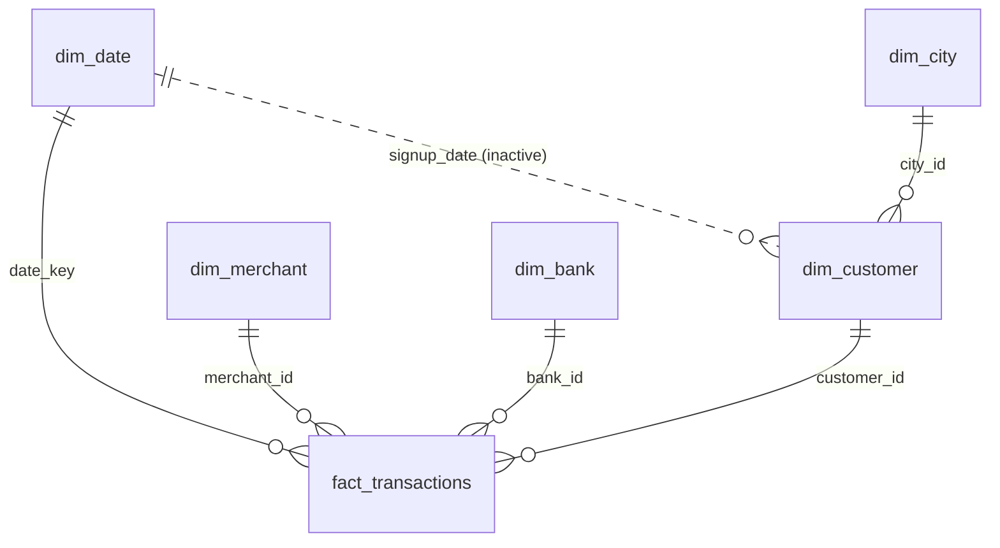

# Power BI build guide: PayFlow UPI Payments

**What you will have at the end:** `PayFlow_UPI_Dashboard.pbix`, a 5-page report on a proper star schema with 36 DAX measures, a custom theme, drill-through-style navigation and an anomaly view. Plan for 2 to 3 hours the first time.

> **Why this is a guide and not a ready `.pbix`:** a `.pbix` can only be authored in Power BI Desktop (Windows). Everything that is hard to type or easy to get wrong is provided here as files: cleaned star-schema data, Power Query (M) code, all DAX, a theme and the exact visuals for each page. Building the report yourself is also what lets you explain it in an interview.

**You need:** Power BI Desktop (free, Windows; on a Mac use a Windows VM or Windows PC at a college lab). Nothing else.

---

## Step 1. Load the data (15 min)

1. Unzip the project. Note the folder `powerbi/data/` (six CSV files).
2. In Power BI Desktop: **Home > Transform data**.
3. **Manage Parameters > New Parameter**: Name `DataFolder`, Type `Text`, Current Value = the full path to `powerbi\data\` **ending with a backslash**.
4. For each file in `powerbi/powerquery/` (`01` to `06`): **New Source > Blank Query > Advanced Editor**, paste the code, then rename the query to the name in the first comment line (`fact_transactions`, `dim_date`, `dim_customer`, `dim_merchant`, `dim_bank`, `dim_city`).
5. **Close & Apply.**

Skills this shows: parameters, typed columns, conditional columns (hour, amount and tenure bands), `Date.StartOfMonth`.

## Step 2. Model the data (20 min)

Open **Model view**. Create these relationships (drag the column on the many side to the one side). All are single-direction, many-to-one.

| From (many) | To (one) | Active |
|---|---|---|
| `fact_transactions[date_key]` | `dim_date[date_key]` | Yes |
| `fact_transactions[customer_id]` | `dim_customer[customer_id]` | Yes |
| `fact_transactions[merchant_id]` | `dim_merchant[merchant_id]` | Yes |
| `fact_transactions[bank_id]` | `dim_bank[bank_id]` | Yes |
| `dim_customer[city_id]` | `dim_city[city_id]` | Yes |
| `dim_customer[signup_date]` | `dim_date[date]` | **No (inactive)**, used by `New Customers` through `USERELATIONSHIP` |

Do **not** relate `dim_merchant[city_id]` or `dim_customer[primary_bank_id]`: each would give two paths to the same dimension and make filters ambiguous. Hide those two columns from Report view.

Then:
- Select `dim_date` > **Table tools > Mark as date table** > `date`.
- `dim_date[month_name]` > **Column tools > Sort by column** > `month_num`. Do the same for `day_name` by `dow`.
- Hide key columns (`*_id`, `date_key`) from Report view.
- Set `fact_transactions[amount]`, `fraud_loss` and `cashback` to **Summarization: Don't summarize** (you will use measures).

## Step 3. Add the measures (20 min)

1. **Home > Enter data**, leave blank, name the table `_Measures`, Load.
2. Open `powerbi/dax/measures.dax` and create each measure on `_Measures` (**Table tools > New measure**). They are grouped by folder in the file; set the **Display folder** for each in Model view.
3. Format: `Success Rate`, `System Failure Rate`, `User Failure Rate`, `Cashback % of TPV`, `P2M Share of TPV`, `TPV MoM %`, `TPV YoY %` as **Percentage** (1 to 2 decimals); `TPV`, `Average Ticket`, `Fraud Loss`, `Value Lost to System Failures` as **Currency** (Rupee symbol, 0 decimals); `Fraud Rate (bps)` as decimal with 1 place.

## Step 4. Import the theme (2 min)

**View > Themes > Browse for themes** > `powerbi/theme/payflow-theme.json`. Page backgrounds become light grey, visuals white with thin borders, and the chart colours match the Excel and web dashboards.

## Step 5. Check your numbers before building visuals (5 min)

Make a temporary **Card** for each measure (no filters). They must match. If one does not, fix the model before going further.

| Measure | Expected |
|---|---|
| Total Transactions | 60,000 |
| Successful Transactions | 56,350 |
| TPV | 6,07,57,051 (Rs 6.08 Cr) |
| Success Rate | 93.92% |
| Average Ticket | 1,078.21 |
| System Failures / System Failure Rate | 2,131 / 3.55% |
| User Failure Rate | 2.36% |
| Fraud Flags / Fraud Rate (bps) | 188 / 31.33 |
| Cashback Paid / Cashback % of TPV | 1,62,942 / 0.27% |
| Avg Response (sec) | 2.479 |
| Active Users (no filter) | 4,420 |
| Value Lost to System Failures | 23,13,066 |
| P2M Share of TPV | 69.56% |
| Month = 2026-10: TPV / Active Users | 45,97,727 / 2,469 |
| Month = 2026-10: TPV MoM % / TPV YoY % | +13.4% / +64.1% |
| Month = 2026-10: New Customers | 252 |
| Highest System Failure Rate bank | Alliance Co-operative Bank, 8.14% |
| Dominion National Bank on 13 Oct 2025 | 70.0% system failure rate |

(The same numbers are in `powerbi/expected_values.json`.)

## Step 6. Build the five pages (60 to 90 min)

Use 16:9 (1280 x 720). Put a title text box at the top left of each page ("Payment reliability", and so on) and keep slicers in one row under it. Apply the same slicer positions on every page.

### Page 1: Overview
| Visual | Fields |
|---|---|
| Slicers (dropdown) | `dim_date[month_key]`, `dim_city[city]`, `dim_merchant[category]` |
| 6 cards | `TPV`, `Total Transactions`, `Success Rate`, `Average Ticket`, `System Failure Rate`, `Fraud Rate (bps)`. Add a reference label on TPV: `TPV MoM %` |
| Line chart | X `dim_date[month_start]`, Y `TPV`. Tooltip fields: `TPV MoM %`, `Active Users` |
| Bar chart | Y `dim_merchant[category]`, X `TPV`, sorted descending |
| Bar chart | Y `dim_bank[bank_name]`, X `Success Rate`, sorted ascending (weakest first). Axis minimum 0.85 |
| Column chart | X `dim_city[tier]`, Y `TPV`, legend `fact_transactions[txn_type]` (100% stacked) |

Add a **text box** with 2 or 3 data-driven takeaways, for example the Oct 2025 Diwali jump and the success-rate range across banks.

### Page 2: Reliability
| Visual | Fields |
|---|---|
| Slicers | `dim_bank[bank_type]`, `fact_transactions[network]` |
| Bar chart | Y `dim_bank[bank_name]`, X `System Failure Rate`. Conditional colour: gradient, white to orange |
| Column chart | X `fact_transactions[txn_hour]`, Y `System Failure Rate` |
| Column chart | X `fact_transactions[network]`, Y `System Failure Rate` |
| Matrix | Rows `dim_bank[bank_name]`, columns `fact_transactions[hour_band]`, values `System Failure Rate`. **Cell elements > Background colour** > gradient. Shows exactly which bank fails at which time |
| Bar chart | Y `fact_transactions[failure_reason]`, X `Failed Transactions`. Visual filter: `failure_reason` is not "No failure" |
| 2 cards | `Value Lost to System Failures`, `Avg Response (sec)` |

On the bank bar chart set **Tooltips > Report page** to a tooltip page (below).

### Page 3: Incident watch and root cause
| Visual | Fields |
|---|---|
| Slicers | `dim_bank[bank_name]` (single select), `dim_date[month_key]` |
| Line chart | X `dim_date[date]` (continuous, not hierarchy), Y `System Failure Rate`. **Analytics pane > Find anomalies > On**, sensitivity about 70. Set Month to 2025-10 and Bank to Dominion National Bank: the 13 to 15 Oct outage is flagged |
| Table | Columns `dim_date[date]`, `Total Transactions`, `System Failure Rate`, `Bank Normal System Failure Rate`, `Chance of Spike by Luck`. Visual filter `Incident Flag` = 1. Select ONE bank in a slicer first |
| Card | `Incident Days` (with Dominion National Bank and 2025-10 selected it must show 3: 13, 14 and 15 Oct) |
| Decomposition tree | Analyze `Failed Transactions`. Explain by `dim_bank[bank_type]`, `fact_transactions[network]`, `fact_transactions[hour_band]`, `dim_customer[age_group]`, `dim_city[tier]` |

### Page 4: Fraud and cashback
| Visual | Fields |
|---|---|
| Column charts (3) | X `hour_band` / `tenure_band` / `amount_band`, Y `Fraud Rate (bps)` |
| Scatter | Details `dim_merchant[category]`, X `TPV`, Y `Cashback % of TPV`, size `Cashback Paid` |
| Bar chart | Y `dim_merchant[category]`, X `Cashback % of TPV` |
| Table | `dim_merchant[merchant_name]`, `Fraud Flags`, `Fraud Loss`. Visual filter: **Top N** 10 by `Fraud Flags` |

### Page 5: Customers and growth
| Visual | Fields |
|---|---|
| Line chart | X `dim_date[month_start]`, Y `Active Users` |
| Column chart | X `dim_date[month_start]`, Y `New Customers` |
| Bar chart | Y `dim_customer[age_group]`, X `User Failure Rate` |
| Column chart | X `dim_city[tier]`, Y `Txns per Active User` |
| Matrix | Rows `dim_customer[kyc_level]`, columns `dim_customer[device_os]`, values `Success Rate` |

### Tooltip page (optional, 5 min)
Add a page, **Page information > Allow use as tooltip**, **Canvas settings > Type: Tooltip**. Place 4 cards: `Success Rate`, `System Failure Rate`, `Total Transactions`, `Value Lost to System Failures`.

### Interactivity (15 min)
- **Navigation:** Insert > Buttons > Navigator > Page navigator on every page.
- **Bookmarks:** "All periods" and "Diwali 2025" (filter `dim_date[festive_name]` = Diwali 2025). Link them to two buttons on page 1.
- **KPI colour:** on the Success Rate card use **Conditional formatting > Font colour > Field value** with the `Success Rate Color` measure.
- **Edit interactions:** stop the page-1 category bar from filtering the KPI cards if you want fixed headline numbers.

## Step 7. Quality checks (10 min)
- Re-check the numbers table above after adding slicers (select 2026-10 and compare).
- **View > Performance analyzer** > Start recording > Refresh visuals. Every visual should finish in well under a second at this size.
- Give every chart a title and a short alt text (**Format > General > Alt text**).
- File name: `PayFlow_UPI_Dashboard.pbix`. Put it in the `powerbi/` folder.

## Step 8. Getting it live (read before promising anything on a resume)

| Option | What it takes | Reality |
|---|---|---|
| **Publish to web** (public link) | Publish to the Power BI service, then File > Embed report > Publish to web | Per Microsoft community answers, it requires a **Pro licence and a work or school account**; a personal Gmail does not work, and your tenant admin must allow it. Check Microsoft's current terms. A Microsoft 365 developer or trial tenant is a way to get one. If you do publish, the link is public to anyone, which is fine here because the data is simulated |
| **Screenshots + short screen recording** | Export each page as PNG. Record 60 to 90 seconds walking through the report (any screen recorder), upload as unlisted video | Works for everyone. Put the video link and 3 screenshots in the README and on LinkedIn. Recruiters often watch instead of opening files |
| **`.pbix` in GitHub** | Commit `PayFlow_UPI_Dashboard.pbix` (a few MB) | Lets reviewers download and open it. Say "download to open in Power BI Desktop" |
| **Web dashboard from this project** | Host `web/index.html` (GitHub Pages or Netlify Drop) | A clickable live link that mirrors the same pages. Label it a web version, not Power BI |

Do not write "published to Power BI Service" on a resume unless you actually did. "Built in Power BI Desktop; web demo and walkthrough video linked" is accurate and strong.

## Troubleshooting
- **Cards show blank:** a relationship is missing or points the wrong way. Check Step 2.
- **`New Customers` is empty:** the inactive relationship `dim_customer[signup_date]` to `dim_date[date]` is missing, or `signup_date` was not typed as Date.
- **Month names out of order:** Sort by column (Step 2).
- **YoY blank for 2025:** expected. There is no 2024 data. YoY works for Jan to Oct 2026.
- **Refresh error after moving the folder:** edit the `DataFolder` parameter (Transform data > Manage Parameters).
